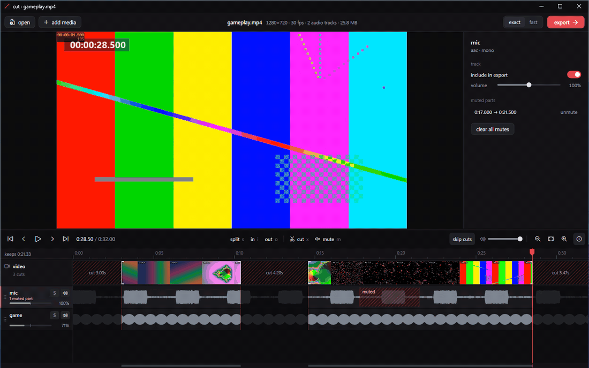

# cut

a small, fast video editor for windows. open a clip, cut out the boring parts, mute what shouldn't be heard, put an image or video on top, and export it at the size you want.

**[how to use it, step by step →](docs/GUIDE.md)**

- **exact cuts you can see.** every cut edge is a 1-pixel line on the exact frame it cuts, with a bracket pointing at what's kept. dragging an edge shows that frame in the preview.
- **a real timeline.** the video, each audio track and any layers get their own lane, with thumbnails and waveforms. drag across a lane to mark a part, then `x` cuts it or `m` mutes it.
- **audio per track.** mute just part of one track, change volume, solo a track while you listen, leave a track out, reorder tracks.
- **layers.** drop images (png with transparency works), gifs, videos or music onto the timeline. drag them on the video to place them, drag a corner to resize.
- **export by size, not by numbers.** a size slider with a live estimate ("≈ 9.4 MB · 96% smaller than the original"), plus presets like "fits discord · 10 mb". resolution and frame rate drop automatically when the size needs it.
- **fast or exact.** fast copies the original with no re-encode (close to instant, each cut starts on a keyframe, shown in amber on the timeline). exact re-encodes on your gpu when it can (nvenc, quick sync, amf) and falls back to the cpu.
- **picks up where you left off.** edits are saved per video automatically.

## install and update

grab `cut-setup-x.y.z.exe` from [releases](https://github.com/NotFuture1/cut/releases) and run it. new versions install straight over the old one (same folder, settings kept, a running cut gets closed for you), so there's nothing to uninstall. cut also tells you when an update is out and can install it itself.

there's a portable zip too if you'd rather not install.

## keys

| key | action |
| --- | --- |
| space | play / pause |
| drag across a lane | mark a part |
| x | cut the marked part (or the selected segment) |
| m | mute the marked part (on that lane, or all audio) |
| s | split the video at the playhead |
| i / o | mark in / out at the playhead |
| delete | remove whatever is selected |
| ← / → | one frame (shift: 1 s, ctrl: 5 s) |
| ↑ / ↓ | jump to the previous / next edit |
| ctrl + z / y | undo / redo |
| ctrl + wheel, + / - | zoom the timeline (`\` fits) |
| p | skip cuts while playing on / off |
| f or double-click the video | full screen preview |
| ctrl + o / i / e | open / add media / export |

hold alt while dragging to turn off snapping.

## build

windows build only, done by github actions: publish (ready-to-run), stage ffmpeg/ffprobe (shared build) and libmpv next to the exe, run a headless selftest (preview graph, layer rendering, every export path checked with ffprobe), run a scripted ui walkthrough with real mouse input that records the guide gifs, then pack the installer and a portable zip. tags `v*` create a release.

local checks from a mac or linux: `dotnet build src/Cut.csproj` compiles everything, and `dotnet run --project tests/SelfTest` runs the core selftest against the system ffmpeg and libmpv.
