# using cut

everything below was recorded from the real app, driven by a script on a windows machine. the gifs are short loops of each step.

- [1. open a video](#1-open-a-video)
- [2. trim the start and end](#2-trim-the-start-and-end)
- [3. cut a part out of the middle](#3-cut-a-part-out-of-the-middle)
- [4. mute part of one track](#4-mute-part-of-one-track)
- [5. tracks: volume, solo, order](#5-tracks-volume-solo-order)
- [6. fast or exact](#6-fast-or-exact)
- [7. put an image or video on top](#7-put-an-image-or-video-on-top)
- [8. add music](#8-add-music)
- [9. watch it back](#9-watch-it-back)
- [10. export at the size you want](#10-export-at-the-size-you-want)
- [keys](#keys)

## the screen

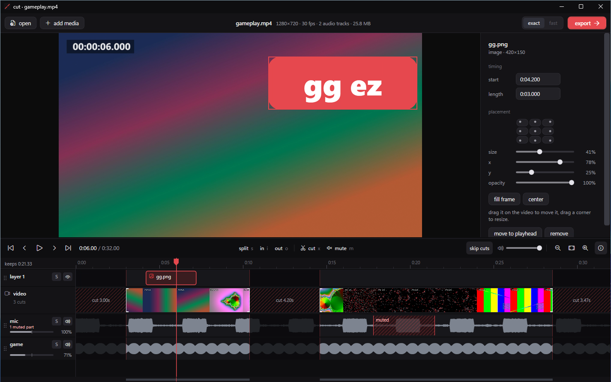

- **top:** open, add media, the file you're editing, fast / exact, export.
- **middle:** the preview, and the details panel for whatever you selected.
- **bottom:** play controls and edit tools, then the timeline. from top to bottom the timeline has your layers, the video (with thumbnails), and one lane per audio track (with waveforms). the strip at the very bottom is the whole video at a glance.

## 1. open a video

drop a video on the window, press `ctrl+o`, or pick one from the recent list. cut reads every audio track in the file (game and mic from obs or shadowplay show up as separate lanes).

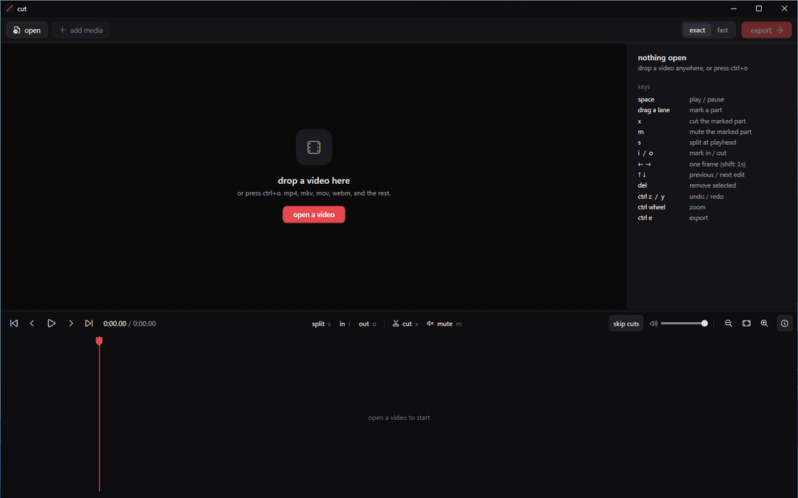

if you've edited this video before, your edits come back. `ctrl+z` steps back through them.

## 2. trim the start and end

grab the bracket at either end of the video lane and drag it. the white line is exactly where the cut is, and the little tabs point at the part you keep. while you drag, the preview shows the exact frame you're cutting on and the bubble shows its time and frame number. edges snap to the playhead, other edges and whole frames (hold `alt` to stop snapping).

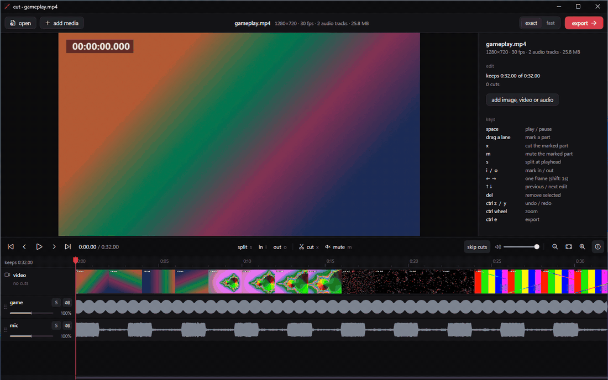

zoom in with `ctrl+wheel` and the ruler grows a tick for every frame, so you can see exactly which frame an edge sits on.

## 3. cut a part out of the middle

drag across the video lane to mark a part, then press `x` (or click **cut**). the gap is shown hatched, with its length. a cut goes through every lane: the audio and layers there are gone too, which is what you want.

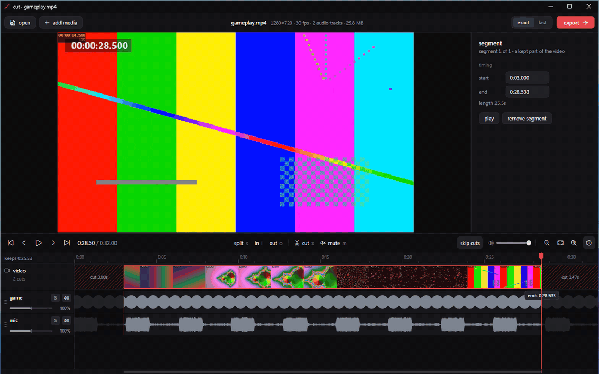

other ways: `i` and `o` mark in and out at the playhead; `s` splits at the playhead and `delete` removes the selected piece. right-click anything for its options.

## 4. mute part of one track

drag across an audio lane (say the mic) to mark a part, then press `m`. only that track goes quiet there; the muted part is drawn hatched red and its edges can be dragged like any other edge. press `m` on a muted part again, or `delete`, to unmute.

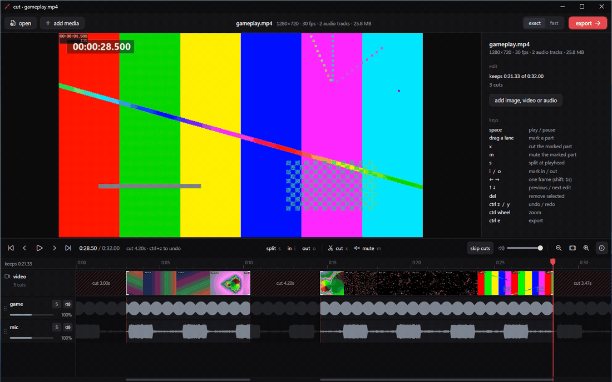

marking a part on the video lane and pressing `m` mutes every track there.

## 5. tracks: volume, solo, order

each audio lane has a small fader under its name: drag it, or double-click to put it back to 100%. **S** solos a lane while you listen (it doesn't change the export), and the speaker button leaves a track out of the export. drag a lane by its dots to reorder the tracks.

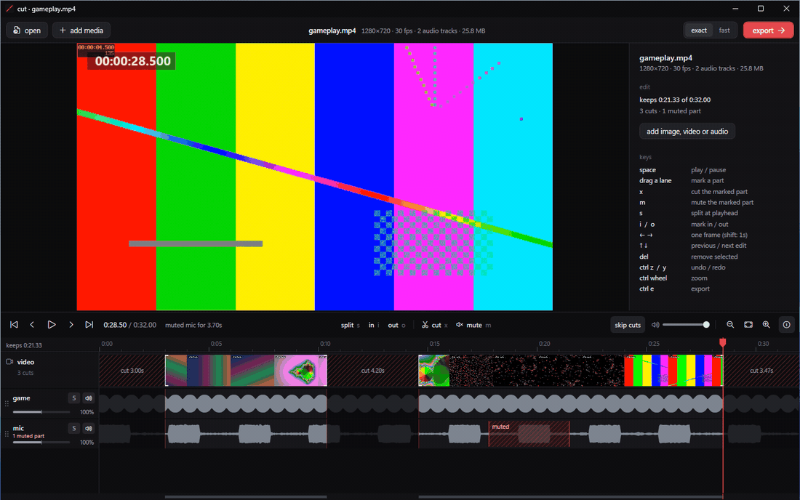

the preview plays all your tracks mixed with these settings, so what you hear is what you export.

## 6. fast or exact

top right picks how the export is made.

- **exact** re-encodes. cuts land on the exact frame, layers get drawn in, and you choose the file size. it uses your graphics card when it can.
- **fast** copies the original video untouched, so it's close to instant and loses nothing. the catch: a copied video can only start on a keyframe, so each cut starts a little earlier than where you put it. in fast mode the timeline shows exactly where in amber, with how much extra you'll get.

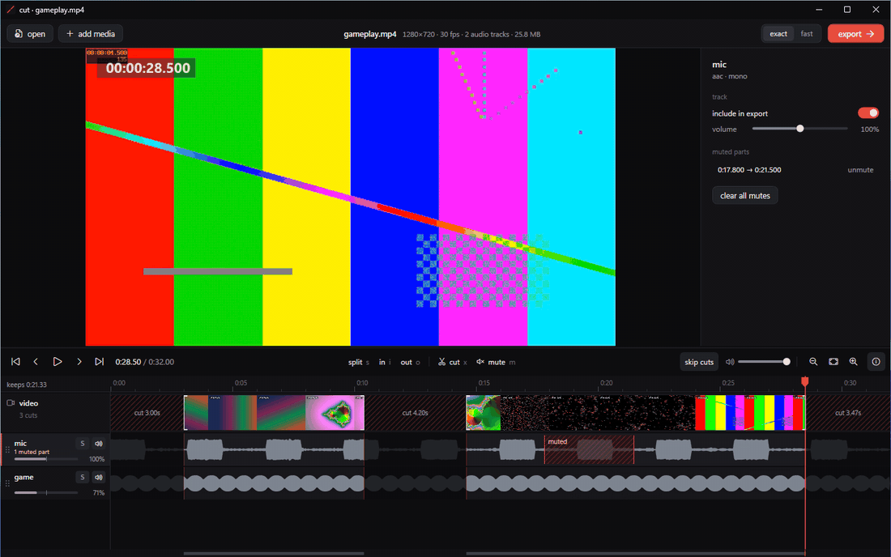

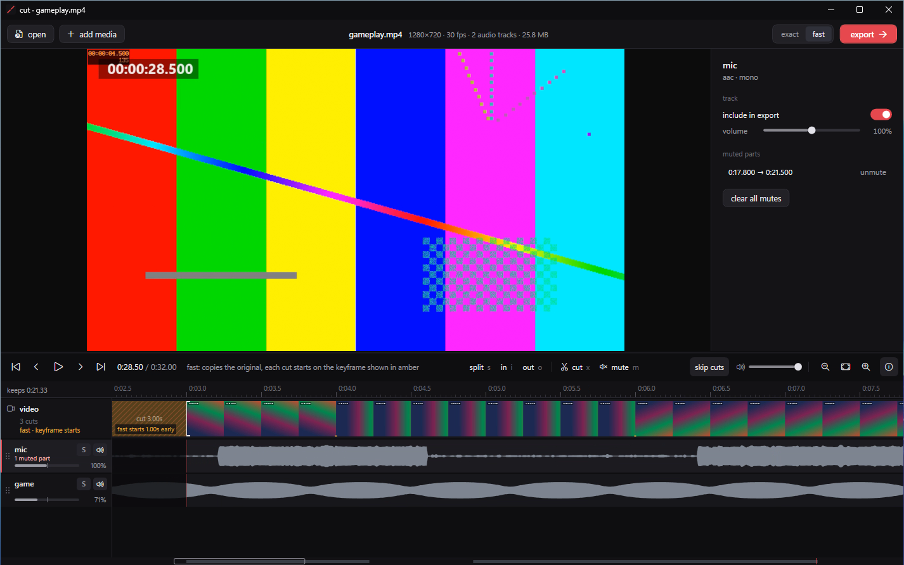

## 7. put an image or video on top

click **add media** (or drop a file on the timeline) to put an image, gif or video over your clip. it lands at the playhead on a layer lane above the video. drag it on the video to move it, drag its bottom-right corner to resize it. move it in time by dragging it on its lane, and trim it from either end. the details panel has snap-to-corner buttons, size, position and opacity.

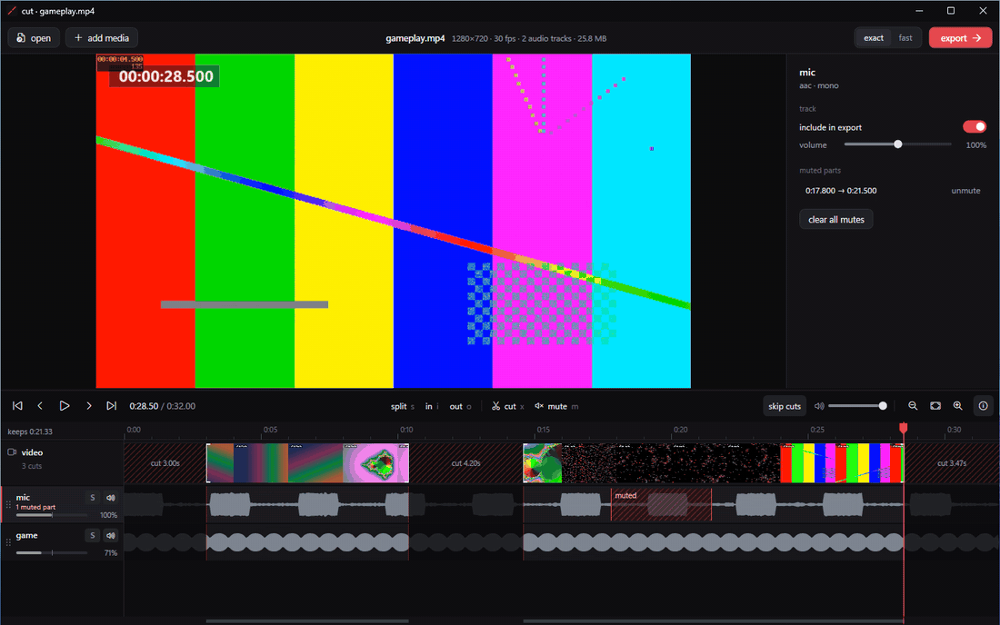

pngs keep their transparency. videos on a layer play their sound too (turn it down or off in the details panel).

## 8. add music

audio files go on a lane of their own. drag the clip to where it should start, trim its ends, and set its volume in the details panel.

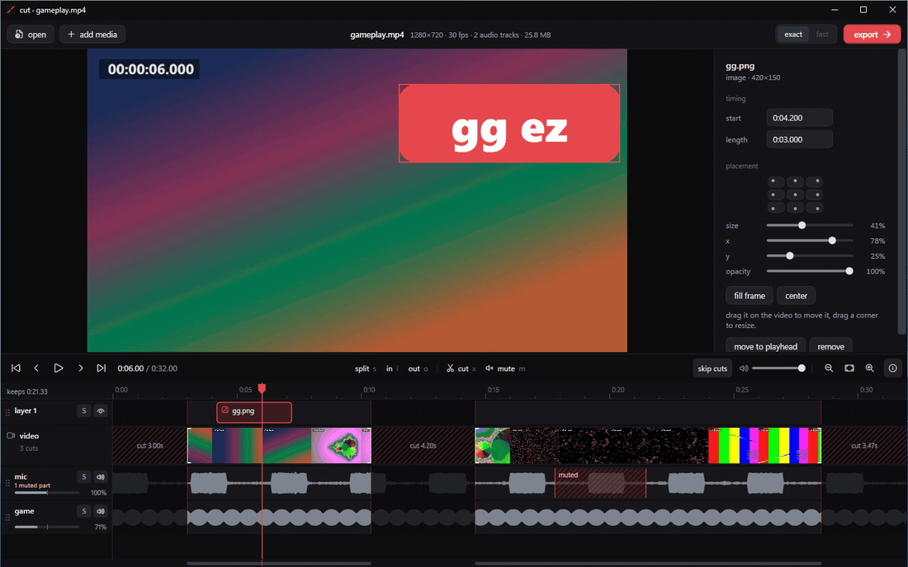

## 9. watch it back

press `space`. with **skip cuts** on (`p`), the preview jumps over everything you cut, so you're watching the result.

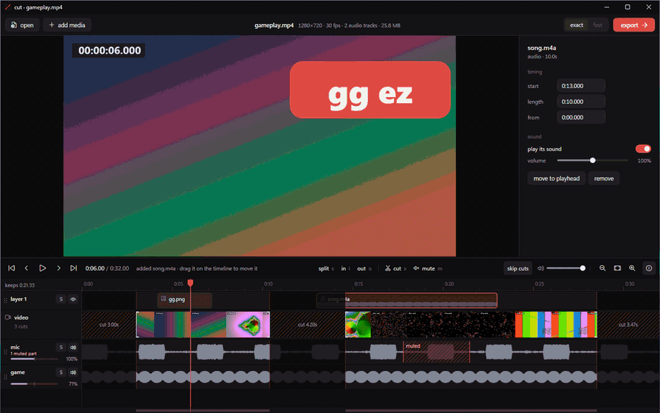

## 10. export at the size you want

press **export** (`ctrl+e`). in exact mode you get a size slider with a live estimate and how much smaller that is than the original. the presets set it for you: **original**, **high**, **small**, **fits discord · 10 mb**, **tiny**. resolution and frame rate drop on their own when the size needs it, or pick them yourself.

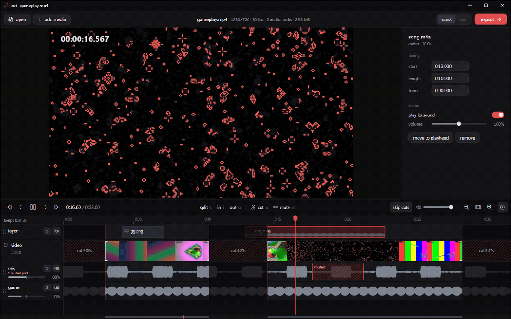

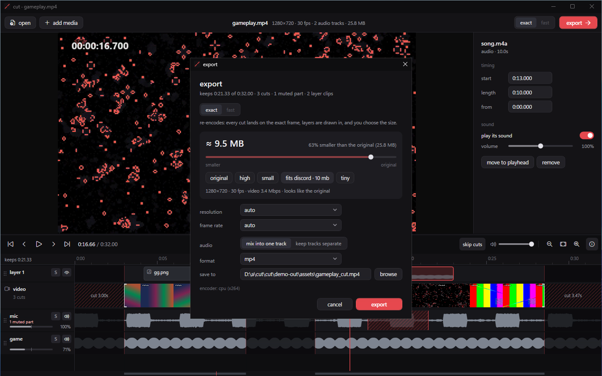

**mix into one track** is the default because discord and most phones only play a file's first audio track. pick **keep tracks separate** if you want them apart.

## keys

| key | action |
| --- | --- |
| space | play / pause |
| drag across a lane | mark a part |
| x | cut the marked part (or the selected segment) |
| m | mute the marked part |
| s | split at the playhead |
| i / o | mark in / out |
| delete | remove the selection |
| ← / → | one frame (shift: 1 s, ctrl: 5 s) |
| ↑ / ↓ | previous / next edit |
| ctrl + z / y | undo / redo |
| ctrl + wheel | zoom the timeline |
| p | skip cuts on / off |
| f | full screen preview |
